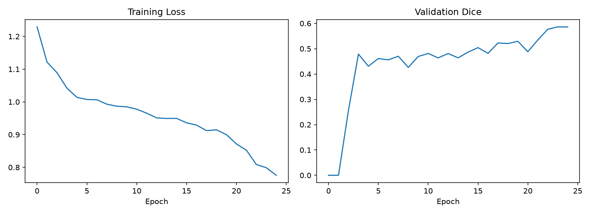
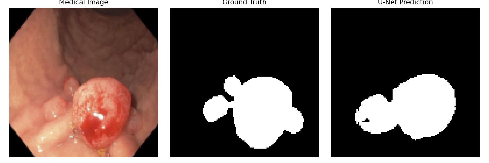

# Medical Image Segmentation Using U-Net (PyTorch)

## Overview

This project implements a lightweight U-Net convolutional neural network from scratch using PyTorch for gastrointestinal polyp segmentation.

The model is trained on the publicly available Kvasir-SEG dataset and predicts binary segmentation masks that identify polyp regions in endoscopy images.

The objective is to explore biomedical image segmentation, convolutional neural network architectures, pixel-level classification, and model evaluation.

**Status:** Baseline implementation (v0.1.0). Further optimization and experiments are planned.

## Dataset

**Dataset:** Kvasir-SEG  
**Source:** https://datasets.simula.no/kvasir-seg/

The dataset contains 1,000 endoscopy images and corresponding segmentation masks.

| Split | Images |
|---|---:|
| Training | 800 |
| Validation | 100 |
| Testing | 100 |

A seeded random split (42) is used for reproducibility.

Images and masks are resized to 128 × 128 pixels. Input images are normalized to the range [0, 1], and masks are converted to binary labels.

## Model Architecture

A lightweight U-Net is implemented using PyTorch.

- Input: RGB images (3 × 128 × 128)
- Encoder: Three convolutional blocks with max pooling
- Bottleneck: 128 feature channels
- Decoder: Three upsampling stages using transposed convolutions
- Skip connections: Concatenation of corresponding encoder and decoder features
- Output: Single-channel segmentation logits (1 × 128 × 128)

The model produces pixel-level foreground probabilities after applying a sigmoid function.

## Training Configuration

| Parameter | Value |
|---|---|
| Framework | PyTorch |
| Epochs | 25 |
| Batch size | 8 |
| Optimizer | Adam |
| Learning rate | 0.001 |
| Loss function | Binary Cross-Entropy + Soft Dice Loss |
| Input resolution | 128 × 128 |
| Training device | CPU |
| Checkpoint selection | Best validation Dice |

## Baseline Results

| Metric | Result |
|---|---:|
| Best validation Dice | 0.5864 |
| Test Dice | 0.6084 |
| Test IoU | 0.4753 |
| Final training loss | 0.7757 |

The highest validation Dice was achieved at epoch 24.

### Training Performance



### Segmentation Example



The model identifies the principal polyp region, although differences remain between the predicted and annotated boundaries.

## Project Structure

```text
medical-unet-segmentation/
├── models/
│   └── unet.py
├── results/
│   ├── training_curves.png
│   └── prediction_example.png
├── dataset.py
├── train.py
├── evaluate.py
├── requirements.txt
└── README.md
```

The raw dataset and model checkpoints are excluded from version control.

## Installation

Create a Python environment and install the dependencies:

```bash
pip install -r requirements.txt
```

Download Kvasir-SEG from the official dataset page and extract the images and masks into:

```text
data/Kvasir-SEG/
├── images/
└── masks/
```

## Running the Project

Verify the dataset:

```bash
python dataset.py
```

Test the U-Net architecture:

```bash
python models/unet.py
```

Train the model:

```bash
python train.py
```

Evaluate the best checkpoint:

```bash
python evaluate.py
```

The training script creates the saved model checkpoint and seeded dataset split required by the evaluation script.

## Limitations

- The model was trained from scratch on a relatively small dataset.
- Images were resized to 128 × 128 pixels, reducing fine boundary detail.
- The baseline does not include data augmentation.
- The baseline uses a lightweight U-Net without pretrained encoder weights.
- Evaluation uses a single seeded random split and one training run.
- Performance has not been validated on independent clinical datasets.

This project is intended for educational and research purposes, not clinical diagnosis.

## Future Work

- Investigate longer training and learning-rate scheduling.
- Introduce synchronized image and mask augmentation.
- Evaluate higher input resolutions.
- Compare BCE-only and BCE–Dice loss functions.
- Investigate transfer learning with pretrained encoders.
- Analyze segmentation failure cases and boundary accuracy.
- Improve reproducibility and conduct additional controlled experiments.

## References

Jha, D., et al. (2020). *Kvasir-SEG: A Segmented Polyp Dataset.* MultiMedia Modeling.

Ronneberger, O., Fischer, P., and Brox, T. (2015). *U-Net: Convolutional Networks for Biomedical Image Segmentation.*

## Technologies

Python, PyTorch, NumPy, Pillow, Matplotlib, scikit-learn, and tqdm.